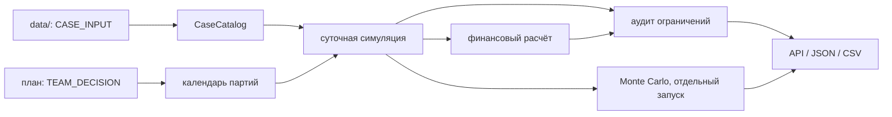

# Расчётное ядро «Топливный космоконтур 2035»

Состояние на **19 сентября 2026 года**. Это техническое описание действующего
прототипа `src/engine/`, а не доказательство оптимальности стратегии и не акт
математической приёмки. Канонические правила и известные ограничения собраны в
[`docs/MODEL.md`](docs/MODEL.md); численные входы расчёта находятся только в
`data/`.

API возвращает `engine.status=prototype` и `model_verified=false`. Стоимость в
результате имеет единицу `mln_units`: исходные материалы не дают основания
автоматически называть её рублями, прибылью, NPV или рентабельностью.

## Поток расчёта



- `loader.py` загружает спрос, источники, хранилища, инвестиции, ограничения и
  сценарии из `data/`.
- `calendar.py` проверяет даты, партии, год получения, мощность и сроки
  подготовки. В каждом модельном году 365 дней; февраль всегда содержит 28
  дней.
- `simulation.py` ведёт физический баланс по дням 2035–2040 годов. Поступление
  учитывается до расхода дня; критический спрос обслуживается первым.
- `finance.py` считает закупку, резервирование, хранение, CAPEX и OPEX.
- `audit.py` формирует проверки ограничений с годом, фактом и величиной
  нарушения.
- `monte_carlo.py` повторяет тот же суточный расчёт для случайных отказов
  реальных партий плана.

## Физический баланс

Для каждого дня расчёт следует равенству

```text
доступно = начальный запас + валовое поступление - потери на поступлении
spill = max(0, доступно - вместимость)
выдано = min(доступно - spill, спрос)
конечный запас = доступно - spill - выдано
дефицит = спрос - выдано
```

`delivered_t` — валовое фактическое поступление. `losses_t` начисляется один
раз на это поступление по `loss_rate_on_throughput`; коэффициент не является
годовым испарением остатка. `spill_t` показывает физический сброс при
переполнении отдельно от модельных потерь. Запас не становится отрицательным,
а дефицит не подменяет запас.

Критический спрос входит в общий: сначала обслуживается критическая часть, затем
оставшаяся коммерческая. Годовые уровни сервиса считаются как выданный объём,
делённый на соответствующий спрос. Норматив 45 дней проверяется по физическому
остатку на 1 января каждого года. Бронь мощности сама по себе запасом не
считается.

ZBO меняет вместимость и коэффициент потерь на поступлении начиная с допустимого
года ввода. Это коэффициенты учебного кейса, а не универсальные характеристики
реальной криогенной системы.

## Поставки и сценарии

План содержит датированные партии `supply_orders`, годовую бронь
`capacity_reservations`, инвестиционные решения и скалярный начальный запас.
Положительная партия без даты не исполняется. Срок подготовки берётся по верхней
границе интервала источника; `year` партии означает год физического получения.

BASE детерминирован: `reliability_profile` не умножает поставку автоматически.
В обязательном стрессе:

- спрос 2038–2040 годов умножается на 1,15;
- цена Earth-Core и Earth-Flex в 2038–2039 годах умножается на 1,25;
- Lunar-ISRU получает фактические доли 0,55 / 0,75 / 1,00;
- ограничение потерь не выше 2% проверяется с 2038 года.

Фиксированные доли Lunar-ISRU не умножаются повторно на reliability. BASE,
обязательный стресс и дополнительные исследовательские сценарии не складываются
скрытно.

### Аварийная поставка в вероятностном прогоне

При отказе обычной партии сбой обнаруживается в её плановую дату получения —
это явное `TEAM_ASSUMPTION`. В этот день создаётся заказ Emergency; дата его
получения равна дате исходной партии плюс максимальный lead time Emergency из
каталога. Для текущего входа это шесть недель. Если прибытие выходит за горизонт,
топливо в расчёт не поступает.

Объём спасательной партии ограничен остатком забронированной и физической
мощности Emergency **в году прибытия** после плановых заказов и ранее созданных
спасательных партий. Исходные отказы обрабатываются по календарю, а совпадения —
по `(source_id, batch_id)`, поэтому порядок строк плана не меняет распределение
дефицитной мощности. Во внутреннем календаре отдельного MC-прогона спасательная
партия имеет собственные `batch_id`, даты, статус и `parent_batch_id` исходной
партии. Top-level `delivery_schedule` обычного `engine.run` остаётся календарём
его детерминированного сценария; API не выдаёт ledgers всех MC-прогонов.

Emergency также проходит отдельное испытание надёжности. Его отказ не вызывает
рекурсивный спасательный заказ. Заказанный спасательный объём входит в закупку и
`payable_volume_t`, даже если Emergency не доставил топливо; годовая плата за
бронь начисляется один раз. В детерминированном BASE отказы не разыгрываются,
поэтому автоматические спасательные партии не появляются.

## Экономика

Для источника и года:

```text
порог take-or-pay = доля take-or-pay × забронированная мощность
оплачиваемый объём = max(заказанный объём, порог take-or-pay)
закупка = оплачиваемый объём × сценарная цена
резервирование = забронированная мощность × ставка резервирования
```

Take-or-pay применяется к сумме партий за год один раз. Резервирование оплачивается
отдельно. Holding cost равен ставке хранения, умноженной на средний конечный
физический остаток 365 модельных дней. CAPEX и OPEX берутся из справочников;
Earth-New учитывает опционный и исполнительный платежи раздельно, без повторного
начисления общей суммы.

`total_cost_mln` — простая сумма годовых затрат в `mln_units`. Для сравнения
принято раскрытое `TEAM_ASSUMPTION`: ставка дисконтирования `r = 0`, поэтому
`PV(cost_y) = cost_y / (1 + r)^(year - 2035) = cost_y`. Это не утверждение о
постоянных реальных ценах и не NPV проекта: выручка во входах отсутствует.
Ненулевой
`initial_inventory_t` пока оценивается по цене Earth-Core и добавляется к закупке
первого года. Источник партии, дата оплаты и отдельный предстартовый период для
этого запаса не моделируются.

## Ограничения и выполнимость

`is_feasible=true` означает, что реализованные hard-проверки данного прогона не
нашли нарушения. В аудит входят годовые уровни сервиса BASE, физический резерв,
переполнение, мощности, лимиты CAPEX, ограничение потерь обязательного стресса и
ограничение на Emergency как базовый канал. Результат относится только к
реализованной семантике и входному плану; он не доказывает полноту ограничений
кейса или глобальную оптимальность.

## Monte Carlo

Штатный риск-расчёт использует 100 прогонов и seed 42. Для каждой датированной
партии выполняется независимое испытание Бернулли с параметром из
`reliability_profile`. Независимость партий — `TEAM_ASSUMPTION`, а не
установленная статистика эксплуатации. В обязательном стрессе Lunar-ISRU не
разыгрывается повторно: его снижение уже задано фактическими долями сценария.

Результат содержит исходную выборку суммарного дефицита, число нулевых прогонов,
медиану, p95 nearest-rank, максимум, полную проверку ограничений каждого прогона,
выборки общей стоимости и закупки Emergency, а также дневные траектории. Поле
`probability_of_no_shortage` означает долю прогонов без дефицита. Совместимое
старое поле `probability_of_zero_shortage` означает долю прогонов без дефицита и
без выявленных физических нарушений. `probability_of_all_constraints` — доля
прогонов, прошедших полный реализованный аудит. Стоимость описывают среднее и p95
для общей суммы и закупки Emergency. Ни одна из этих долей или статистик не
является гарантией будущей надёжности.

## Стратегии и выбор

В текущем каталоге `data/strategies/` есть пять сравниваемых планов; код
`src/engine/strategies.py` загружает их без отдельного набора чисел. Они
сравниваются одним ядром на одинаковых входах. Для каждого сценария выбрать
можно только самый дешёвый **среди выполнимых** планов; если выполнимых планов
нет, результатом выбора остаётся «нет выполнимой альтернативы». Более дешёвый
план с нарушениями не объявляется победителем.

`src/engine/optimize.py` и `tools/optimize_strategy.py` содержат
экспериментальный поиск в заранее ограниченном пространстве решений. Он не
встроен в API/UI, не перебирает все допустимые планы и не доказывает глобальный
оптимум. Готовые стратегии являются `TEAM_DECISION`.

Воспроизводимый сравнительный пакет формирует отдельный анализ; его манифест,
таблицы альтернатив, чувствительности, рисков и Monte Carlo находятся в
`reports/`. Основная интерпретация и границы приведены в
[`reports/REPORT.md`](reports/REPORT.md).

## Границы прототипа

- математическая приёмка владельцем модели не завершена;
- календарь не содержит високосных дней;
- стоимость не дисконтируется;
- начальный запас не имеет полноценной предстартовой цепочки происхождения;
- обнаружение отказа только в плановую дату получения и правила распределения
  Emergency являются допущениями реализации;
- спасательная партия за пределами 2040 года не помогает внутри горизонта;
- reliability-профили не подтверждены эксплуатационной статистикой внутри
  репозитория;
- агрегированная модель не заменяет проектирование ракеты, траектории, баков,
  тепломассопереноса и операций стыковки;
- успешные unit/API/frontend проверки подтверждают реализацию и контракты, но не
  научную валидацию коэффициентов.
