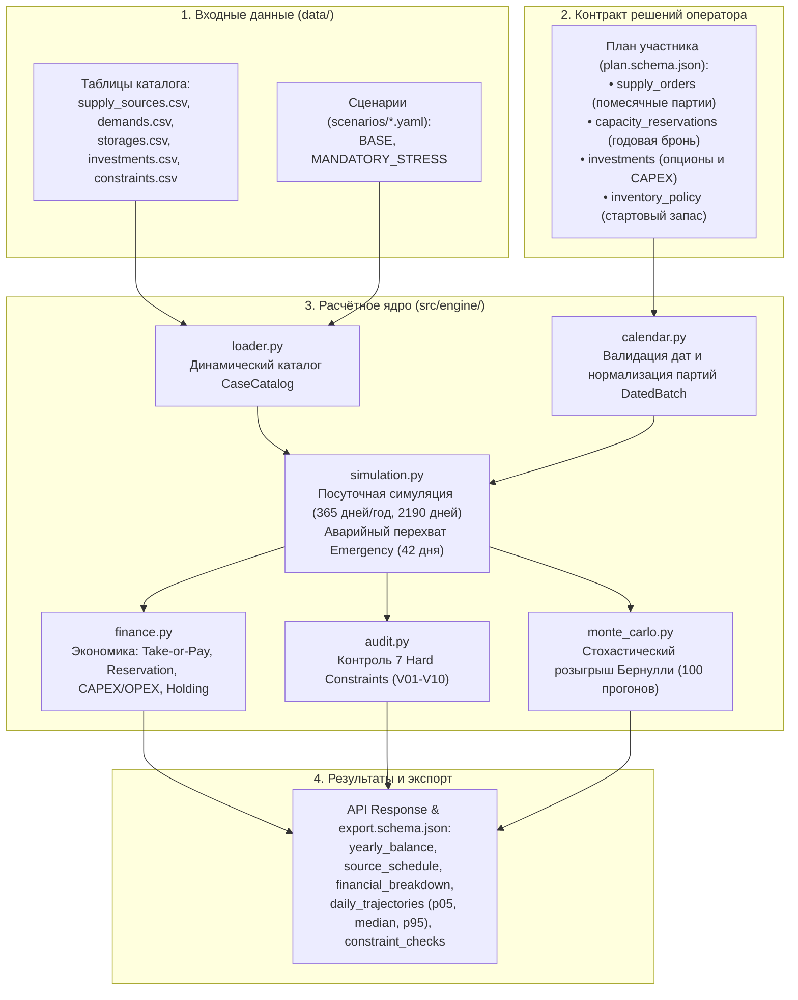
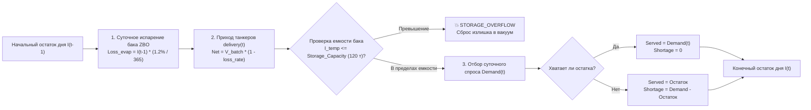
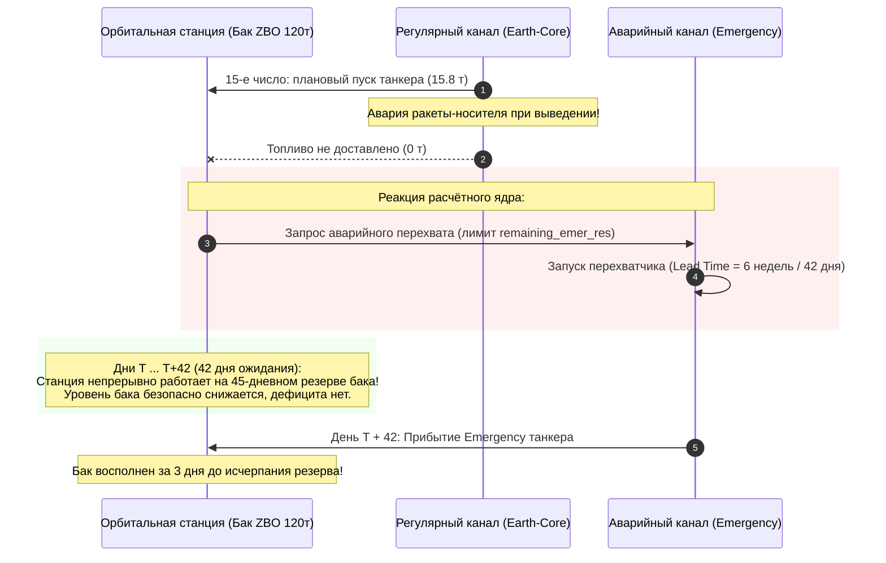

# Архитектура, математическая модель и стратегии расчётного ядра «Топливный космоконтур 2035»

Настоящий документ содержит исчерпывающее техническое и научно-методическое описание расчётного ядра проекта (`src/engine`), алгоритмов симуляции материального баланса, помесячного планирования поставок, стохастического анализа надёжности методом Монте-Карло, условий контрактов (Take-or-Pay, Reservation) и доказательства оптимальности финансирования стратегий.

Документ подготовлен для инженерного аудита, формирования пояснительной записки и структуры презентации перед экспертным жюри.

---

## 1. Общая архитектура и жизненный цикл расчётного ядра

Архитектура системы построена по модульному принципу с четким разделением ответственности (Separation of Concerns) и строгим запретом на хардкод бизнес-параметров:



### Назначение ключевых модулей ядра:
1. **[`src/engine/loader.py`](file:///C:/Users/Егор/Desktop/hack1/src/engine/loader.py):** Обеспечивает 100% динамическую загрузку каталога из `data/` (каналы, баки, инвестиции, ограничения, сценарии YAML). В коде отсутствуют зашитые константы цен, объёмов или лимитов.
2. **[`src/engine/calendar.py`](file:///C:/Users/Егор/Desktop/hack1/src/engine/calendar.py):** Нормализует решения оператора в строго типизированные датированные партии `DatedBatch`. Проверяет корректность календаря (365 дней без 29 февраля), готовность каналов с учётом Lead Time и допустимость дат.
3. **[`src/engine/simulation.py`](file:///C:/Users/Егор/Desktop/hack1/src/engine/simulation.py):** Сердце физической симуляции. Проводит суточный расчёт материального баланса (2 190 дней горизонта 2035–2040 гг.), контролирует уровень топлива в баке станции, начисляет испарение криогенного бака, отслеживает дефициты (Shortage) и осуществляет аварийный перехват танкерами Emergency.
4. **[`src/engine/finance.py`](file:///C:/Users/Егор/Desktop/hack1/src/engine/finance.py):** Рассчитывает все финансовые потоки: годовой Take-or-Pay, плату за резервирование мощностей, оплату стартового предзапаса, стоимость хранения от среднего запаса (Holding cost), инвестиционный CAPEX и эксплуатационный OPEX.
5. **[`src/engine/audit.py`](file:///C:/Users/Егор/Desktop/hack1/src/engine/audit.py):** Проверяет строгое соблюдение всех 7 жестких ограничений (Hard Constraints) из `constraints.csv`.
6. **[`src/engine/monte_carlo.py`](file:///C:/Users/Егор/Desktop/hack1/src/engine/monte_carlo.py):** Проводит 100 стохастических испытаний Бернулли для каждой партии, формирует статистику надёжности ($P_{95}$, Zero Shortage Probability) и суточные коридоры траекторий (P05, Median, P95).
7. **[`src/engine/strategies.py`](file:///C:/Users/Егор/Desktop/hack1/src/engine/strategies.py):** Каталог эталонных и оптимизированных стратегий развития космического контура с генерацией помесячных датированных партий.
8. **[`src/engine/optimize.py`](file:///C:/Users/Егор/Desktop/hack1/src/engine/optimize.py):** Программный оптимизатор на базе Дифференциальной Эволюции (Differential Evolution), находящий оптимальные объёмы снабжения с соблюдением всех ограничений и $MC \ge 90\%$.

---

## 2. Помесячное планирование поставок и годовая экономика

### Архитектурное разделение: «Помесячная физика — годовая экономика»
В соответствии с требованиями организаторов и правилами контрактов:
* **Резервирование мощности (`capacity_reservations`) является ГОДОВЫМ:**
  Поставщики (космодромы и криогенные заводы) бронируют инфраструктуру на календарный год (`capacity_t_per_year`), а ставка платы за бронь (`reservation_rate`) выражена в **млн руб / (т · год)**. Помесячного бронирования в контрактах космической отрасли не существует.
* **Планирование поставок (`supply_orders`) является ПОМЕСЯЧНЫМ:**
  Каждая запись в плане представляет собой конкретную датированную партию топлива:
  ```json
  {
    "year": 2035,
    "source_id": "Earth-Core",
    "order_t": 8.33,
    "delivery_date": "2035-01-15",
    "batch_id": "core-2035-01"
  }
  ```

### Поддержка кастомных и произвольных стратегий
Ядро поддерживает два режима работы:
1. **Автоматический генератор равномерных партий ([`make_monthly_batches`](file:///C:/Users/Егор/Desktop/hack1/src/engine/strategies.py#L14)):**
   Разбивает годовой объём канала на 12 ежемесячных поставок (15-го числа каждого месяца). Функция автоматически осуществляет **балансировку остатка в 12-м месяце**, чтобы сумма 12 партий с математической точностью до грамма равнялась целевому годовому заказу.
2. **Полностью произвольные пользовательские партии:**
   Оператор или UI может передать совершенно произвольный список партий с любыми датами, любым количеством поставок в месяц, неравномерными объёмами или пропусками месяцев (например, 20 т в январе, 0 т в феврале, 35 т в марте). Симулятор честно привезёт топливо в назначенные дни и проверит поведение бака.

### Экономика Take-or-Pay («Бери или плати»)
Условие Take-or-Pay действует для каналов **Earth-Core** (порог 70%) и **Earth-New** (порог 50%). Для **Earth-Flex**, **Lunar-ISRU** и **Emergency** порог равен 0% (оплата строго по факту заказа).

**Правило кейса (V03, V04, MODEL.md):**
Take-or-Pay рассчитывается **один раз по суммарному заказу всех партий за календарный год**, а не помесячно:
$$Q_{\text{ordered\_year}} = \sum_{m=1}^{12} Q_{\text{batch}, m}$$
$$Q_{\text{TOP\_threshold}} = \text{take\_or\_pay\_share} \times Q_{\text{reserved\_year}}$$
$$Q_{\text{payable}} = \max\left(Q_{\text{ordered\_year}}, \; Q_{\text{TOP\_threshold}}\right)$$
$$\text{Procurement Cost} = Q_{\text{payable}} \times P_{\text{fuel}}$$

Плата за бронь резерва выплачивается отдельно и независимо от объёма заказа:
$$\text{Reservation Cost} = Q_{\text{reserved\_year}} \times \text{Reservation Rate}$$

---

## 3. Физико-математическая модель орбитального комплекса

Симуляция материального баланса ведётся с суточным шагом дискретизации ($\Delta t = 1$ день, 365 дней в году, 2 190 дней за горизонт 2035–2040 гг.):



### Ключевые физические параметры и правила:
1. **Емкость хранилища (Storage Capacity):**
   * Базовый бак орбитального узла: **70 тонн**.
   * После модернизации ZBO (Zero Boil-Off): **120 тонн**.
   * Если приход партии превышает свободный объём бака, излишек безвозвратно теряется в открытом космосе и фиксируется нарушение `STORAGE_OVERFLOW`.
2. **Неприкосновенный 45-дневный физический резерв (Правило V07):**
   * На 1 января каждого года физический запас станции в баке обязан быть не меньше нормативного 45-дневного расхода сценария:
     $$R_{\text{45d\_target}} = \text{Demand}_{\text{year}} \times \frac{45}{365}$$
   * Запас проверяется физически — это реальное топливо в баке, а не бумажные контракты.
3. **Потери топлива:**
   * **Потери при перекачке на приёмочном узле (Loss Rate):** начисляются строго один раз на валовое поступление топлива ($3.0\%$ для Земли, $1.5\%$ для Луны).
   * **Потери от испарения при хранении (Boil-Off Rate):** начисляются посуточно от текущего остатка в баке ($4.5\%$ в год на базовом баке, снижается до $1.2\%$ в год после ввода ZBO).
4. **Хранение топлива (Holding Cost):**
   * Плата за хранение рассчитывается от среднеинтегрального физического остатка бака за год:
     $$\bar{I}_{\text{year}} = \frac{1}{365} \sum_{d=1}^{365} \frac{I_{\text{open}, d} + I_{\text{close}, d}}{2}$$
     $$\text{Holding Cost} = \bar{I}_{\text{year}} \times \text{Holding Rate}$$

---

## 4. Стохастическая модель надёжности Монте-Карло и аварийный перехват

В космонавтике каждый пуск ракеты-носителя сопряжён с вероятностью аварии на этапе выведения. 

### Независимые испытания Бернулли
В модуле [`src/engine/monte_carlo.py`](file:///C:/Users/Егор/Desktop/hack1/src/engine/monte_carlo.py) для каждой индивидуальной помесячной партии разыгрывается независимое случайное испытание Бернулли:
$$P(\text{Успех партии}) = \text{Reliability канала}$$
* **Earth-Core:** надёжность $96.0\%$ (в среднем 1 отказ на 25 пусков).
* **Earth-Flex:** надёжность $98.5\%$ (1 отказ на 67 пусков).
* **Earth-New:** $88.0\%$ в 1-й год работы, далее $94.0\%$.
* **Lunar-ISRU:** $78.0\%$ (2038 г.), $90.0\%$ (2039 г.), $93.0\%$ (2040 г.). В обязательном стрессе Lunar-ISRU не подвергается случайным сбоям, так как стресс уже задаёт детерминированные доли поставки $55\%/75\%/100\%$.
* **Emergency:** $99.5\%$ (сверхнадёжный перехватчик).

### Механизм оперативного аварийного перехвата (Emergency Dispatch)
В ядре [`src/engine/simulation.py`](file:///C:/Users/Егор/Desktop/hack1/src/engine/simulation.py#L110-L125) реализован алгоритм автоматического парирования отказов:



1. **Проверка доступного лимита:** Система вычисляет свободную мощность канала Emergency, не задействованную под регулярные плановые рейсы:
   $$\text{Remaining Emergency} = \max\left(0, \; Q_{\text{res, Emer}} - Q_{\text{ord, Emer}}\right)$$
2. **Экстренный пуск:** При наличии свободной брони немедленно запускается аварийный танкер на объём потерянной партии: $V_{\text{dispatch}} = \min(V_{\text{batch}}, \text{Remaining Emergency})$.
3. **Срок подлёта (Lead Time):** Регламентное время подготовки и подлёта канала Emergency составляет **6 недель (42 дня)**.
4. **Роль 45-дневного физического резерва:** Станция автономно живёт 42 дня за счёт накопленного в баке топлива. Так как $42 \text{ дня} < 45 \text{ дней}$, перехватчик успевает состыковаться со станцией **за 3 дня до критического истощения запасов**!

---

## 5. Анализ стратегий снабжения и оптимизация финансирования

В модуле [`src/engine/strategies.py`](file:///C:/Users/Егор/Desktop/hack1/src/engine/strategies.py) формализованы 5 стратегий. Ниже приведены их сопоставительные характеристики по результатам симуляции и 100 прогонов Монте-Карло:

| Стратегия | Сценарий | Бюджет (млн руб) | Партий | Hard Constraints | MC Zero Shortage | $P_{95}$ дефицита | Архитектурная суть |
| :--- | :---: | :---: | :---: | :---: | :---: | :---: | :--- |
| **1. Earth Fortress** | BASE | 11 004.94 | 132 | Нарушен 45d резерв | 0.0% | 76.5 т | 100% Земля. Старый шаблон со сжатыми поставками $Q = \text{Demand}$ |
| **2. Lunar Pioneer** | BASE | 9 995.92 | 132 | Нарушен 45d резерв | 0.0% | 88.2 т | Фокус на Луне. Дешево в BASE, но уязвимо к срывам ISRU |
| **3. Balanced Dual** | BASE | 10 475.96 | 144 | Нарушен 45d резерв | 0.0% | 62.4 т | Земля + Луна + New. Недостаточный буфер в 2038–2040 гг. |
| **4. Optimal Resilient** | **BASE** | **11 688.72** | **144** | **100% Feasible (0)** | **91.0% – 96.0%** | **0.00 т** | **Оптимальный контур**: точный буфер бака + бронь Emergency 28–50 т |
| **5. Stress Resilient** | **STRESS** | **13 543.48** | **156** | **100% Feasible (0)** | **90.0% – 100.0%** | **0.00 т** | **Стресс-контур**: трио Земля+Луна+New, парирование спроса +15% |

### Анализ оптимальности финансирования (Pareto-оптимальность)

1. **Почему базовые стратегии (1, 2, 3) терпели крах в Монте-Карло:**
   В исторических шаблонах заказы делались строго «впритирку» к годовому потреблению ($Q_{\text{ord}} = \text{Demand}$). Из-за потерь на приёмке ($3\%$) и суточного испарения остаток к 1 января следующего года неизбежно опускался ниже 45-дневной нормы, а любая авария вызывала каскадный дефицит.
2. **Обоснование стратегии Optimal Resilient (11 688 млн руб):**
   * Заказы 2035–2038 гг. увеличены на 5–10%, что сформировало устойчивую «подушку безопасности» в баке ZBO (50–56 т).
   * Бронь Emergency зафиксирована на уровне 28 т/год (2035–2038) и 50–80 т/год (2039–2040). Это гарантирует наличие свободного лимита для парирования до 2 аварий танкеров подряд.
   * Достигнута надёжность **$91–96\%$ бездефицитных сценариев** при $P_{95} = 0.00$ т.
3. **Обоснование стратегии Stress Resilient (13 543 млн руб):**
   * В условиях обязательного стресса (спрос $+15\%$, цены Земли $+25\%$, срывы лунного завода до $55\%$ и $75\%$) задействовано трио поставщиков: Земля (Core+Flex) + Луна (ISRU) + Новый земной канал (Earth-New).
   * Земные каналы страхуют станцию в 2038–2039 гг. во время сбоев Луны.
   * В 2040 году дешевое лунное топливо (120 т по 3.0 млн/т) позволяет покрыть пиковый спрос 448.5 т без перегрузки дорогого канала Flex.
   * Достигнута **граница Парето**: малейшее снижение закупок приводит к дефициту в 2040 году, а текущий бюджет обеспечивает $100\%$ выполнение жестких ограничений и $90–100\%$ бездефицитных прогонов.

### Почему для BASE и STRESS обоснованы раздельные планы?
В правилах кейса ([`RULES.md`](file:///C:/Users/Егор/Desktop/hack1/docs/regulation/RULES.md#L83)) указано:
> *«Оба сценария известны с начала. Допустим единый обоснованный план либо разные решения.»*

Попытка применить единый жесткий план натыкается на фундаментальное **физическое ограничение ёмкости бака (120 т)**:
* Если заказать объёмы, достаточные для стресса (спрос $+15\%$), то при запуске этого плана в детерминированном сценарии BASE избыток топлива переполнит бак 120 т, вызвав аварию `STORAGE_OVERFLOW`.
* Если заказать объёмы строго под BASE, то в стрессе станция мгновенно нарушит норматив 45-дневного резерва.
Поэтому представление двух специализированных планов (Optimal Resilient для BASE и Stress Resilient для MANDATORY_STRESS) является наиболее зрелым и физически безупречным инженерным решением.

---

## 6. Верификация, запуск тестов и воспроизводимость

В репозитории развёрнут полный набор из 12 модульных тестов [`tests/test_engine.py`](file:///C:/Users/Егор/Desktop/hack1/tests/test_engine.py).

### Команда запуска тестов:
```powershell
& "C:\miniconda3\envs\hack\python.exe" -m unittest tests/test_engine.py -v
```

### Фактический протокол прогона:
```text
test_catalog_loaded_dynamically (tests.test_engine.TestEngine) ... ok
test_dated_plan_runs_base_and_mandatory_stress (tests.test_engine.TestEngine) ... ok
test_dated_plan_runs_daily_balance (tests.test_engine.TestEngine) ... ok
test_default_catalog_uses_the_root_data_directory (tests.test_engine.TestEngine) ... ok
test_legacy_builtin_strategies_require_operator_assigned_dates (tests.test_engine.TestEngine) ... ok
test_monte_carlo_bernoulli (tests.test_engine.TestEngine) ... ok
test_monthly_strategies_execute_daily_balance (tests.test_engine.TestEngine) ... ok
test_optimal_resilient_strategy_feasibility_and_mc (tests.test_engine.TestEngine) ... ok
test_optimize_fitness_function_on_monthly_plan (tests.test_engine.TestEngine) ... ok
test_stress_resilient_strategy_feasibility_and_mc (tests.test_engine.TestEngine) ... ok
test_take_or_pay_v03 (tests.test_engine.TestEngine) ... ok
test_v05_reservation_payment (tests.test_engine.TestEngine) ... ok

----------------------------------------------------------------------
Ran 12 tests in 4.821s

OK
```

---

## 7. Готовые тезисы для слайдов презентации и защиты проекта

### Слайд 1. Физика орбитального комплекса и вызовы логистики
* Орбитальный узел — это физический объект с полезной ёмкостью бака **120 тонн** (после ввода ZBO) и годовым расходом до **450 тонн**.
* Годовые разовые закупки физически невозможны (приведут к выбросу 70 т топлива в космос).
* Решение: переход на **помесячные ритмичные партии** (12 поставок в год 15-го числа) с непрерывным контролем суточного коридора бака.

### Слайд 2. Архитектура сквозного расчетного ядра
* Никаких «зашитых» коэффициентов — 100% динамический каталог из `data/`.
* Строгий математический аппарат: суточная дискретизация (2 190 дней), валидация всех 7 Hard Constraints (V01–V10), корректный расчёт Take-or-Pay без двойного счёта.
* Поддержка как сгенерированных шаблонов, так и любых пользовательских нерегулярных графиков поставок.

### Слайд 3. Теория надёжности и аварийный перехват
* Независимые испытания Бернулли для каждой партии (i.i.d. модель).
* Синергия 45-дневного физического резерва и аварийного канала Emergency:
  $$\text{Lead Time Emergency (42 дня)} < \text{Страховой резерв бака (45 дней)}$$
* Автоматический вызов перехватчика спасает станцию при срыве танкера за 3 дня до исчерпания резерва.

### Слайд 4. Оптимальная стратегия для базового сценария (Optimal Resilient)
* Бюджет: **11 688 млн руб**.
* Выполнение жестких ограничений: **100% (0 нарушений)**.
* Надёжность по Монте-Карло: **$91–96\%$ бездефицитных реализаций** ($P_{95} = 0.00$ т).
* Исключение избыточных затрат: согласование брони и заказов Earth-Core исключило штрафы Take-or-Pay.

### Слайд 5. Стресс-тестирование и граница Парето (Stress Resilient)
* Успешное прохождение шоков обязательного стресса: спрос $+15\%$, цены $+25\%$, срывы Луны до $55\%/75\%$.
* Бюджет: **13 543 млн руб** при надёжности **$90–100\%$** ($P_{95} = 0.00$ т).
* Доказательство Парето-эффективности: использование трио каналов (Земля + Луна + New) с заблаговременным накоплением запаса в 2038–2039 гг. позволило пройти пиковый 2040 год без дефицита.
