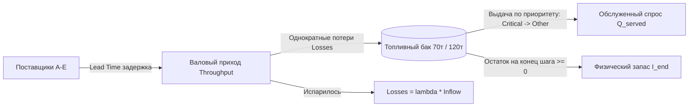
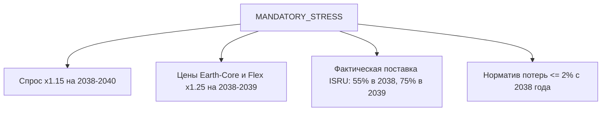

# Полная математическая модель кейса «Топливный космоконтур 2035»
### Исчерпывающая спецификация: физика, баланс, дискретизация, финансы, стресс-тесты и валидационные тесты V01–V10

---

## Содержание
1. [Введение и физический контекст](#1-введение-и-физический-контекст)
2. [Классификация параметров: CASE_INPUT, TEAM_DECISION, TEAM_ASSUMPTION](#2-классификация-параметров)
3. [Входные данные и константы (CASE_INPUT)](#3-входные-данные-и-константы-case_input)
4. [Временная шкала и внутригодовая дискретизация (Timestep)](#4-временная-шкала-и-внутригодовая-дискретизация-timestep)
5. [Предстартовый период и инициализация запаса на 2035 год](#5-предстартовый-период-и-инициализация-запаса-на-2035-год)
6. [Уравнения материального баланса топлива](#6-уравнения-материального-баланса-топлива)
7. [Уравнения финансового баланса и дисконтирования](#7-уравнения-финансового-баланса-и-дисконтирования)
8. [Система 6 обязательных жестких ограничений (Hard Constraints)](#8-система-6-обязательных-жестких-ограничений-hard-constraints)
9. [Стресс-сценарий MANDATORY_STRESS](#9-стресс-сценарий-mandatory_stress)
10. [Контрольные проверочные векторы (V01–V10)](#10-контрольные-проверочные-векторы-v01v10)
11. [Пошаговый алгоритм работы расчетного ядра (Execution Pipeline)](#11-пошаговый-алгоритм-работы-расчетного-ядра-execution-pipeline)

---

## 1. Введение и физический контекст

Орбитальный топливный узел (депо) обеспечивает заправку криогенным топливом космических кораблей цислунарной транспортной системы (маршрут Земля — Луна) на горизонте **2035–2040 годов (6 лет)**.

### Физические законы системы:
1. **Топливо не перемещается мгновенно:** заказ сегодня поступает на станцию только после истечения срока выполнения заказа (**Lead Time** от 1 месяца до 2 лет).
2. **Топливо испаряется:** при приеме (валовой перекачке throughput) возникают потери испарения $\lambda$ (4.5% в базовом баке, 1.2% после модернизации ZBO). Потери начисляются **один раз на входящий поток**; повторно начислять их на складской остаток запрещено.
3. **Емкость бака ограничена:** базовый бак вмещает **70 тонн**, модернизированный ZBO — **120 тонн**. Превышение емкости в любой момент времени — физическая авария (`STORAGE_OVERFLOW`).
4. **Неснижаемый запас:** на 1 января каждого года в баке обязан лежать физический запас минимум на **45 дней вперед** от годового спроса этого года ($D_y \cdot 45 / 365$).
5. **Физический запас неотрицателен:** остаток топлива $I(t) \ge 0$. Если топлива не хватает для заправки, возникает дефицит ($Shortage$), но остаток не уходит в минус.



---

## 2. Классификация параметров

Все параметры в модели строго разделяются на 3 категории:
* **`CASE_INPUT`:** Данные организатора. Менять их запрещено (спрос, цены, лимиты, обязательный стресс, V01–V10).
* **`TEAM_DECISION`:** Решения команды/оператора (объемы бронирования $Q_{res}$, заказов $Q_{order}$, даты инвестиций $x_{inv}$, график поставок).
* **`TEAM_ASSUMPTION`:** Допущения команды (дисконтная ставка $NPV$, выбор шага времени — месяц/день, распределение дефицита, сценарии собственных рисков).

---

## 3. Входные данные и константы (`CASE_INPUT`)

### А. Таблица спроса по годам ($D$)
Единица: **тонны в год**.

| Год $y$ | Базовый общий спрос $D_{total}(y)$ | Базовый критический спрос $D_{crit}(y)$ | 45-дневный резерв $R(y) = D_{total} \cdot \frac{45}{365}$ | Низкий спрос $D_{low}(y)$ | Высокий спрос $D_{high}(y)$ |
|:---:|:---:|:---:|:---:|:---:|:---:|
| **2035** | 100.0 т | 80.0 т | **12.33 т** | 80.0 т | 110.0 т |
| **2036** | 140.0 т | 105.0 т | **17.26 т** | 112.0 т | 154.0 т |
| **2037** | 190.0 т | 135.0 т | **23.42 т** | 152.0 т | 209.0 т |
| **2038** | 250.0 т | 170.0 т | **30.82 т** | 200.0 т | 312.5 т |
| **2039** | 320.0 т | 210.0 т | **39.45 т** | 256.0 т | 400.0 т |
| **2040** | 390.0 т | 250.0 т | **48.08 т** | 312.0 т | 487.5 т |

> **Смысловое правило:** Критический спрос **строго входит** в общий ($D_{crit} \subset D_{total}$). Складывать их нельзя. Для сценариев low/high доля критического спроса сохраняется от базового года.

---

### Б. Таблица 5 каналов снабжения

| ID | Канал | Макс. мощность $Cap(s)$, т/год | Переменная цена $P(s)$, млн/т | Ставка брони $r(s)$, млн/т-год | Take-or-Pay $\alpha(s)$ | Срок доставки $LT(s)$ | Надежность (метаданные рисков) | Доступность |
|:---:|:---|:---:|:---:|:---:|:---:|:---:|:---:|:---|
| **A** | **Earth-Core** | 190 | 6.2 | 0.45 | **70%** (0.70) | **12 мес.** | 0.96 | с 2035 г. |
| **B** | **Earth-Flex** | 110 | 8.9 | 0.15 | **0%** (0.00) | **4 мес.** | 0.985 | с 2035 г. |
| **C** | **Earth-New** | 130 | 7.1 | 0.30 | **50%** (0.50) | **18–24 мес.** | 0.88 (год 1), 0.94 (далее) | После инвестиций |
| **D** | **Lunar-ISRU** | 120 | 3.0 | 0.00 | **0%** (0.00) | **1–2 мес.** | 0.78 / 0.90 / 0.93 (38–40) | с 2038 г. (после CAPEX) |
| **E** | **Emergency** | 80 | 13.8 | 0.35 | **0%** (0.00) | **6 недель** | 0.995 | с 2035 г. |

* **Правило надежности (Reliability):** В штатном сценарии BASE модель **строго детерминирована**! Поставки **НЕ умножаются** на коэффициент надежности ($Q_{deliv} \neq Q_{order} \cdot reliability$). Коэффициенты надежности используются только в отдельном вероятностном блоке рисков.
* **Правило аварийного канала (Emergency):**
  1. Lead time равен **6 неделям** (не переводить скрыто в 1.5 месяца).
  2. Годовая мощность 80 т/год **не означает**, что 80 т лежат на станции. Канал требует 6 недель на доставку.
  3. Запрещено использовать как регулярный источник снабжения более 2 лет подряд ($\text{Streak}(E) \le 2$).

---

### В. Опции хранилища и инвестиции

1. **Базовое хранилище (Base Storage):**
   * Емкость: $V_{storage} = 70$ т.
   * Потери при перекачке: $\lambda = 4.5\% = 0.045$.
   * Стоимость хранения: $h = 0.72$ млн у.е./т-год от среднего физического запаса.
   * CAPEX = 0, OPEX = 0.
2. **Модернизация ZBO (Zero Boil-Off):**
   * Доступна как инвестиционный выбор с 2036 года.
   * Разовый $CAPEX = 180$ млн у.е.
   * Новая емкость: $V_{storage} = 120$ т.
   * Потери снижаются до: $\lambda = 1.2\% = 0.012$.
   * Дополнительный $OPEX = 12$ млн у.е./год (начисляется с момента ввода).
3. **Завод Lunar-ISRU (Луна):**
   * Разовый $CAPEX = 1250$ млн у.е. (обязан быть профинансирован до 2038 года).
   * Ввод в эксплуатацию: с 2038 года.
   * Дополнительный $OPEX = 70$ млн у.е./год (начисляется с 2038 года).
4. **Канал Earth-New (Новый космодром):**
   * Опцион на подготовку: $90$ млн у.е.
   * Реализация при вводе: $270$ млн у.е.
   * Итоговый суммарный $CAPEX = 90 + 270 = \mathbf{360}$ млн у.е. (360 — это сумма, а не третий платеж поверх 90 и 270). Подготовка занимает 18–24 месяца.

---

## 4. Временная шкала и внутригодовая дискретизация (Timestep)

> **Критическое архитектурное правило:** Сравнения только годовых сумм **недостаточно**. Если привезти 150 тонн одной партией в бак емкостью 70 тонн — произойдет переполнение бака ($150 > 70$). Если топливо приедет в декабре, а корабли прилетали в марте — произойдет срыв миссий и дефицит.

Модель использует дискретный шаг времени $t$. Рекомендуемый стандарт — **помесячный шаг ($m \in \{1, \dots, 12\}$ для каждого года $y$, всего 72 расчетных периода)**:
* Длительность шага: $\Delta t = \frac{1}{12}$ года ($\approx 30.42$ дня).
* Спрос распределяется равномерно внутри года:
  $$D_{total}(y, m) = \frac{D_{total}(y)}{12}, \quad D_{crit}(y, m) = \frac{D_{crit}(y)}{12}$$
* Lead Time в месяцах:
  * Earth-Core: 12 шагов;
  * Earth-Flex: 4 шага;
  * Earth-New: 18–24 шага;
  * Lunar-ISRU: 1–2 шага;
  * Emergency: 6 недель $\approx 1.5$ шага (доставка через 42 дня).

---

## 5. Предстартовый период и инициализация запаса на 2035 год

На 1 января 2035 года действует жесткое ограничение 45-дневного резерва:
$$I_{start}(2035) \ge D_{total}(2035) \cdot \frac{45}{365} = 100 \cdot \frac{45}{365} \approx 12.33\text{ т}$$

### Правило предстартового запаса (`AGENTS.md`):
1. Начальный запас **не является бесплатным** и не может возникнуть из ниоткуда.
2. Команда обязана указать источник, дату заказа в подготовительном периоде (2034 год или ранее с учетом Lead Time канала) и стоимость.
3. Финансовые затраты на закупку начального запаса $I_{start}(2035)$ включаются в расходы **первого года** (2035 г.) расчетного горизонта.
4. Один и тот же объем запрещено учитывать одновременно и как начальный запас, и как приход 2035 года (запрет двойного счета).

---

## 6. Уравнения материального баланса топлива

Для каждого периода $t$ (месяца):

### Шаг 1. Валовый приход топлива (Throughput) с учетом задержки
Топливо поступает только по заказам, сделанным $LT(s)$ месяцев назад:
$$Q_{deliv}(s, t) = Q_{order}(s, t - LT(s))$$
$$Throughput(t) = \sum_{s} Q_{deliv}(s, t)$$

### Шаг 2. Однократные потери испарения при приеме
$$Losses(t) = \lambda(t) \cdot Throughput(t)$$
где $\lambda(t) = 0.045$ (базовый склад) или $0.012$ (после модернизации ZBO).

### Шаг 3. Выдача топлива кораблям (с приоритетом критического спроса)
Всего доступно топлива для выдачи:
$$FuelAvailable(t) = I_{start}(t) + Throughput(t) - Losses(t)$$
Фактически выданный объем:
$$Q_{served}(t) = \min\Big(D_{total}(t), \; FuelAvailable(t)\Big)$$

#### Приоритет распределения при дефиците:
В первую очередь закрывается критический спрос:
$$Q_{served, crit}(t) = \min\Big(D_{crit}(t), \; Q_{served}(t)\Big)$$
$$Q_{served, non\_crit}(t) = Q_{served}(t) - Q_{served, crit}(t)$$

### Шаг 4. Расчет дефицита (Shortage)
$$Shortage_{total}(t) = \max\Big(0, \; D_{total}(t) - Q_{served}(t)\Big)$$
$$Shortage_{crit}(t) = \max\Big(0, \; D_{crit}(t) - Q_{served, crit}(t)\Big)$$

### Шаг 5. Физический остаток на конец шага
$$I_{end}(t) = FuelAvailable(t) - Q_{served}(t)$$
* **Строгое граничное условие:** $I_{end}(t) \ge 0$. Отрицательный запас физически невозможен.
* $I_{start}(t+1) = I_{end}(t)$.

---

## 7. Уравнения финансового баланса и дисконтирования

Все суммы — в **млн условных денежных единиц в ценах 2035 года**.

Полная стоимость года $y$:
$$TotalCost(y) = Cost_{proc}(y) + Cost_{res}(y) + Cost_{hold}(y) + CAPEX(y) + OPEX(y)$$

### 1. Закупка топлива ($Cost_{proc}$) с условием Take-or-Pay
Take-or-Pay рассчитывается за **годовой контрактный период**:
$$Q_{pay}(s, y) = \max\Big(Q_{order}(s, y), \; \alpha(s) \cdot Q_{res}(s, y)\Big)$$
$$Cost_{proc}(y) = \sum_{s} P(s, y) \cdot Q_{pay}(s, y)$$
* **Запрет двойного счета:** Take-or-Pay уже включен в $\max(\dots)$. Добавлять его отдельным штрафом запрещено.
* При внутригодовом шаге месячные объемы суммируются за год; нельзя создавать искусственные помесячные минимумы Take-or-Pay.

### 2. Плата за бронирование мощности ($Cost_{res}$)
Для годового периода:
$$Cost_{res}(s, y) = r(s) \cdot Q_{res}(s, y)$$
Если канал задействован на часть года $\Delta t$ (например, при вводе в эксплуатацию):
$$Cost_{res}(s, \Delta t) = r(s) \cdot Q_{res}(s) \cdot \Delta t \quad (\text{пропорционально периоду})$$

### 3. Расходы на хранение ($Cost_{hold}$)
Начисляются на **средний физический запас с учетом времени**:
$$Cost_{hold}(y) = 0.72 \cdot \bar{I}(y)$$
где при помесячном расчете: $\bar{I}(y) = \frac{1}{12} \sum_{m=1}^{12} \left( \frac{I_{start}(m) + I_{end}(m)}{2} \right)$.

### 4. Капитальные инвестиции ($CAPEX$)
$$CAPEX(y) = 180 \cdot x_{ZBO}(y) + CAPEX_{ISRU}(y) + CAPEX_{New}(y)$$
*(где $CAPEX_{New} = 90$ млн при покупке опциона и $270$ млн при завершении подготовки).*

### 5. Эксплуатационные расходы ($OPEX$)
$$OPEX(y) = 12 \cdot \mathbb{I}_{\{ZBO\_active(y)\}} + 70 \cdot \mathbb{I}_{\{ISRU\_active(y)\}}$$

### 6. Дисконтирование расходов ($NPV$)
Если команда рассчитывает приведенную стоимость жизненного цикла:
$$NPV = \sum_{y=2035}^{2040} \frac{TotalCost(y)}{(1 + r)^{y - 2035}}$$
* Реальная ставка $r$ (например, $r=8\%$ или $r=10\%$) объявляется как `TEAM_ASSUMPTION` и должна оставаться неизменной при сравнении всех альтернатив.
* В задаче нет выручки, поэтому показатель отражает **дисконтированные расходы**, а не прибыль.

---

## 8. Система 6 обязательных жестких ограничений (Hard Constraints)

План объявляется **неисполнимым**, если хотя бы в одном периоде нарушено хотя бы одно ограничение:

| № | Ограничение | Формула проверки | Диагностическое сообщение |
|:---:|:---|:---|:---|
| **C1** | **Превышение мощности канала** | $Q_{res}(s, y) \le Cap(s)$ и $Q_{order}(s, y) \le Q_{res}(s, y)$ | `CAPACITY_EXCEEDED` (source, year, excess) |
| **C2** | **Переполнение бака** | $I_{end}(t) \le V_{storage}(t)$ ($70$ т без ZBO, $120$ т с ZBO) | `STORAGE_OVERFLOW` (month, year, excess) |
| **C3** | **45-дневный неснижаемый резерв** | $I_{start}(y, 1\text{ янв}) \ge D_{total}(y) \cdot \frac{45}{365}$ | `RESERVE_45D_VIOLATION` (year, shortage) |
| **C4** | **Уровень обслуживания (BASE)** | $SL_{total}(y) = \frac{\sum Q_{served}}{\sum D_{total}} \ge 0.97$<br>$SL_{crit}(y) = \frac{\sum Q_{served, crit}}{\sum D_{crit}} \ge 0.99$ | `SERVICE_LEVEL_VIOLATION` (year, actual, target) |
| **C5** | **Потолки инвестиций (CAPEX)** | $\sum_{y=2035}^{2037} CAPEX(y) \le 1800$ млн<br>$\sum_{y=2035}^{2040} CAPEX(y) \le 2800$ млн | `CAPEX_LIMIT_EXCEEDED` (milestone, excess) |
| **C6** | **Лимит аварийного канала** | $\text{ConsecutiveYears}(E) \le 2$ года | `EMERGENCY_STREAK_EXCEEDED` (years) |

---

## 9. Стресс-сценарий `MANDATORY_STRESS`

Обязательный стресс-тест задан организатором единоразово и применяется изолированно от BASE:



### Точные математические изменения параметров:

1. **Спрос:**
   $$D_{total}(y) = D_{total, BASE}(y) \cdot 1.15, \quad \forall y \in [2038, 2040]$$
   $$D_{crit}(y) = D_{crit, BASE}(y) \cdot 1.15, \quad \forall y \in [2038, 2040]$$
2. **Переменные цены Earth-Core ($A$) и Earth-Flex ($B$):**
   * В 2038 г.: $P(A) = 6.2 \cdot 1.25 = \mathbf{7.75}$, $P(B) = 8.9 \cdot 1.25 = \mathbf{11.125}$
   * В 2039 г.: $P(A) = 7.75$, $P(B) = 11.125$
   * В 2040 г.: цены возвращаются к исходным ($6.2$ и $8.9$).
   * Тарифы бронирования ($r$) и CAPEX шоком **не изменяются**.
3. **Недопоставка Lunar-ISRU ($D$):**
   * В 2038 г.: $Q_{deliv}(D, 2038) = \mathbf{0.55} \cdot Q_{order}(D, 2038)$
   * В 2039 г.: $Q_{deliv}(D, 2039) = \mathbf{0.75} \cdot Q_{order}(D, 2039)$
   * В 2040 г.: $Q_{deliv}(D, 2040) = \mathbf{1.00} \cdot Q_{order}(D, 2040)$
   * **Правило неотмены оплаты:** Недопоставка **не отменяет** платеж! Оплата закупки рассчитывается от заказанного объема $Q_{order}$. Доли 55% и 75% **не умножаются повторно на надежность**.
4. **Потолок потерь:**
   * С 2038 года действует норматив: $\frac{Losses}{Throughput} \le 0.02$ ($2\%$).
   * В базовом баке потери составляют 4.5% ($> 2\%$). Следовательно, план **обязан ввести модернизацию ZBO к 2038 году**, иначе стресс-тест завершится ошибкой нарушения норматива потерь.

---

## 10. Контрольные проверочные векторы (V01–V10)

Для проверки расчетного ядра организатором предоставлены 10 эталонных синтетических тест-векторов из [`test_oil/validation/expected_checks.json`](file:///C:/Users/Vasya/Desktop/хакатон/test_oil/validation/expected_checks.json):

| Тест ID | Что проверяет математика | Входные данные | Ожидаемый результат проверки |
|:---:|:---|:---|:---|
| **V01** | Формула матбаланса | $I_{start}=10$, $Deliv=30$, $Loss=2$, $Served=25$ | $I_{end} = 10 + 30 - 2 - 25 = \mathbf{13}$ т |
| **V02** | Дефицит вместо отрицательного запаса | $I_{start}=0$, $Deliv=8$, $Loss=0$, $Demand=10$ | $Served = 8$ т, $Shortage = \mathbf{2}$ т, $I_{end} = \mathbf{0}$ т (не -2) |
| **V03** | Минимум Take-or-Pay | $Q_{res}=100$, $Q_{order}=50$, $\alpha=0.7$, $P=2$ | $Q_{pay} = \max(50, 70) = \mathbf{70}$ т, Платеж = $\mathbf{140}$ млн |
| **V04** | Отсутствие двойного начисления ToP | Входы V03 | Итоговый переменный платеж строго $\mathbf{140}$ млн (без повторного штрафа) |
| **V05** | Пропорциональная плата за бронь | $Q_{res}=100$, $r=0.4$, $\Delta t = 0.5$ года | Плата за бронь = $100 \cdot 0.4 \cdot 0.5 = \mathbf{20}$ млн |
| **V06** | Потери испарения только один раз | $Inflow=20$ т, $\lambda=0.05$ | $Losses = 20 \cdot 0.05 = \mathbf{1}$ т (к остатку повторно не применять) |
| **V07** | Расчет 45-дневного резерва | Годовой спрос $D=365$ т | Резерв = $365 \cdot \frac{45}{365} = \mathbf{45}$ т |
| **V08** | Диагностика превышения мощности | $Cap=10$ т/год, Заказ $Q_{res}=12$ т/год | Ошибка `CAPACITY_EXCEEDED`, величина превышения = $\mathbf{2}$ т |
| **V09** | Критический спрос вложен в общий | Общий спрос = $100$ т, Критический = $60$ т | Общий спрос = $\mathbf{100}$ т (не складывать в 160 т) |
| **V10** | Запрет повторного умножения на reliability | $Plan=20$ т, Доля стресса $=0.50$, Reliability $=0.80$ | Факт доставки = $20 \cdot 0.50 = \mathbf{10}$ т (не $10 \cdot 0.8 = 8$ т) |

---

## 11. Пошаговый алгоритм работы расчетного ядра (Execution Pipeline)

```text
[1. Инициализация]
  ├── Загрузить demand.csv, supply_sources.csv, storage_options.csv, investment_options.csv, constraints.csv
  └── Принять начальный запас I_start(2035) >= 12.33 т и его оплату в расходах 2035 г.

[2. Прием решений оператора]
  ├── Матрица Q_res(s, y) и Q_order(s, y) по 5 каналам на 6 лет
  └── Годы инвестиций: x_ZBO, x_ISRU, x_New

[3. Выбор сценария]
  ├── Режим BASE: стандартные таблицы
  └── Режим MANDATORY_STRESS: спрос x1.15, цены Core/Flex x1.25, поставки ISRU 55%/75%, лимит потерь <= 2%

[4. Внутригодовой расчет динамики (по месяцам m = 1..72)]
  ├── Сдвиг заказов на Lead Time -> определение даты поступления Q_deliv
  ├── Расчет валового прихода Throughput и однократных потерь Losses = lambda * Throughput
  ├── Выдача топлива: сначала Q_served_crit, затем остальной спрос
  ├── Расчет остатка в баке: I_end = I_start + Throughput - Losses - Q_served
  ├── Проверка физических границ: I_end >= 0 и I_end <= V_storage
  └── Накопление среднего запаса для оплаты хранения

[5. Финансовый расчет (по годам y = 2035..2040)]
  ├── Закупка: P * max(Q_order, alpha * Q_res)
  ├── Бронирование: r * Q_res
  ├── Хранение: 0.72 * средний_запас
  ├── CAPEX строек и постоянный OPEX заводов
  └── Расчет итоговых и дисконтированных (NPV) затрат

[6. Валидация 6 жестких ограничений]
  ├── Проверка C1-C6
  └── Формирование списка структурированных ошибок (год, параметр, величина)

[7. Экспорт результатов]
  └── Генерация итогового файла export.csv согласно export.schema.json
```
