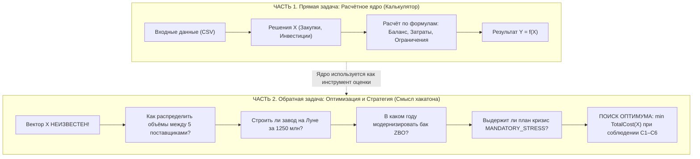
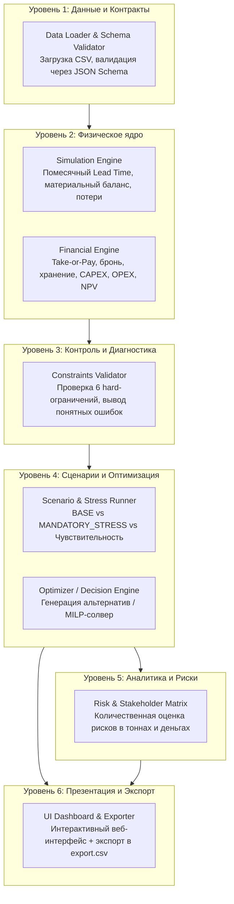
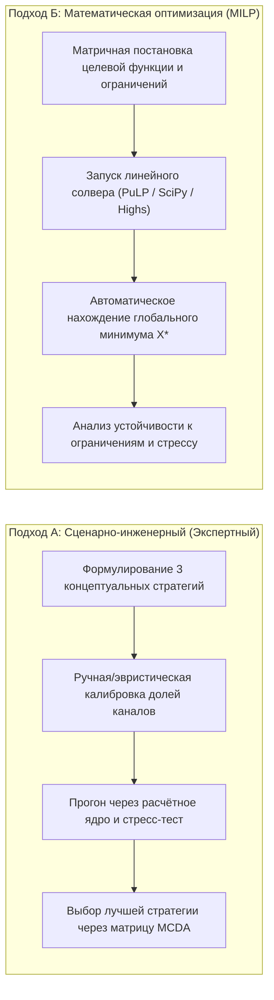

# Декомпозиция задачи и типовые пути решения
### Руководство по архитектуре решений, математической оптимизации и стратегическим компромиссам кейса «Топливный космоконтур 2035»

---

## Содержание
1. [Суть задачи: почему это не просто «подставить формулы»](#1-суть-задачи-почему-это-не-просто-подставить-формулы)
2. [Математическая постановка задачи принятия решений (MILP)](#2-математическая-постановка-задачи-принятия-решений-milp)
3. [Архитектурная декомпозиция системы на модули](#3-архитектурная-декомпозиция-системы-на-модули)
4. [Ключевые инженерно-экономические дилеммы (Trade-offs)](#4-ключевые-инженерно-экономические-дилеммы-trade-offs)
5. [Типовые пути решения задачи](#5-типовые-пути-решения-задачи)
6. [Сравнение альтернативных стратегий снабжения](#6-сравнение-альтернативных-стратегий-снабжения)
7. [Пошаговый план реализации для команды разработки](#7-пошаговый-план-реализации-для-команды-разработки)

---

## 1. Суть задачи: почему это не просто «подставить формулы»

Вся задача кейса четко делится на **две принципиально разные части**:



1. **Часть 1 (Прямая задача — 25 баллов):**
   * Формулы физики, потерь, Take-or-Pay и ограничений жестко заданы организатором в [`docs/Task/math.md`](file:///C:/Users/Vasya/Desktop/хакатон/kosmo-piter_vibecoders_47/docs/Task/math.md).
   * Здесь нет пространства для догадок: формулы нужно запрограммировать и подтвердить прохождением 10 эталонных тестов V01–V10.
2. **Часть 2 (Обратная задача — 75 баллов):**
   * Организаторы **не предоставили** плана закупок и графика строек.
   * Команда должна сама сформулировать вектор решений $X$, минимизирующий расходы и гарантирующий выживаемость системы в кризисном сценарии.

---

## 2. Математическая постановка задачи принятия решений (MILP)

С точки зрения прикладной математики задача относится к классу **смешанного целочисленного линейного программирования (Mixed Integer Linear Programming, MILP)** в цепях поставок при наличии неопределенности.

### Целевая функция (Критерий оптимизации)
Найти вектор управленческих решений $X^*$, минимизирующий суммарные (или дисконтированные $NPV$) расходы за 6 лет (2035–2040):
$$\min_{X} \quad \sum_{y=2035}^{2040} TotalCost(y, X)$$
где:
$$TotalCost(y) = \sum_{s} \Big[ P(s, y) \cdot \max\big(Q_{order}(s, y), \, \alpha(s) Q_{res}(s, y)\big) + r(s) Q_{res}(s, y) \Big] + Cost_{hold}(y) + CAPEX(y) + OPEX(y)$$

### Вектор искомых переменных ($X$):
1. **Непрерывные переменные объемов ($Q \ge 0$):**
   * $Q_{res}(s, y)$ — забронированная мощность у поставщика $s \in \{A, B, C, D, E\}$ на год $y$ (30 переменных).
   * $Q_{order}(s, y)$ — заказанный объем топлива у поставщика $s$ на год $y$ (30 переменных).
2. **Бинарные переменные инвестиций ($x \in \{0, 1\}$):**
   * $x_{ZBO}(y)$ — флаг инвестирования в ZBO (180 млн) в год $y \in \{2036, 2037, 2038\}$.
   * $x_{ISRU}(y)$ — график выплат CAPEX завода Луны (1250 млн суммарно до 2038 г.).
   * $x_{New\_opt}(y), x_{New\_exec}(y)$ — покупка опциона (90 млн) и ввод Earth-New (270 млн).

### Область допустимых решений (Система ограничений):
План $X$ допустим тогда и только тогда, когда выполняются:
1. **Баланс потоков:** $I_{end}(t) = I_{start}(t) + Throughput(t) - Losses(t) - Q_{served}(t) \ge 0, \quad \forall t$;
2. **Отсутствие дефицита:** $Q_{served}(t) = D_{total}(t) \implies Shortage(t) = 0, \quad \forall t$;
3. **Неснижаемый 45-дневный резерв:** $I_{start}(y, 1\text{ янв}) \ge D_{total}(y) \cdot \frac{45}{365}, \quad \forall y$;
4. **Физическая емкость бака:** $I_{end}(t) \le V_{storage}(t) \quad (\forall t)$;
5. **Лимиты пропускной способности каналов:** $Q_{order}(s, y) \le Q_{res}(s, y) \le Cap(s), \quad \forall s, y$;
6. **Бюджетные потолки строек:**
   $$\sum_{y=2035}^{2037} CAPEX(y) \le 1800 \text{ млн}, \quad \sum_{y=2035}^{2040} CAPEX(y) \le 2800 \text{ млн};$$
7. **Ограничение аварийного канала:** $\text{Streak}(Emergency) \le 2$ года подряд;
8. **Робастность к стрессу:** при подстановке вектора $X$ в сценарий `MANDATORY_STRESS` дефицит критического спроса не должен приводить к катастрофическому срыву ($SL_{crit} \approx 1.0$), а потери должны удовлетворять нормативу $\le 2\%$.

---

## 3. Архитектурная декомпозиция системы на модули

Для создания устойчивого программного продукта система разбивается на 6 независимых слоев:



---

## 4. Ключевые инженерно-экономические дилеммы (Trade-offs)

В условиях кейса заложены внутренние противоречия между дешевизной, капиталоемкостью, скоростью и гибкостью:

### Дилемма 1. Строить ли лунный завод Lunar-ISRU?
* **Плюсы:** Топливо стоит всего **3.0 млн/т** (на Земле 6.2 и 8.9). За 2038–2040 годы спрос станции составляет 960 тонн. Закупка 960 тонн с Земли стоит от 6 000 до 8 500 млн у.е. Закупка с Луны — 2 880 млн у.е.
* **Минусы:** Требуется заморозить гигантский $CAPEX = 1250$ млн до 2038 года (при общем лимите 1800 млн к концу 2037 г.) и платить $OPEX = 70$ млн/год.
* **Риск в стрессе:** В сценарии кризиса завод ломается: в 2038 г. выдает лишь **55%**, в 2039 г. — **75%**. При этом оплата не возвращается! Если у вас нет резерва на Земле, на станции наступает дефицит.

### Дилемма 2. В каком году строить модернизацию бака ZBO?
* **Почему ZBO неизбежен:** Без ZBO бак вмещает лишь 70 тонн, а потери составляют 4.5%. В стресс-тесте с 2038 года действует жесткое правило: потери должны быть $\le 2\%$. Без ZBO стресс-тест не пройти в принципе.
* **Тайминг:** ZBO стоит 180 млн CAPEX + 12 млн/год OPEX.
  * Если строить в **2036 году**: сразу снижаются потери (с 4.5% до 1.2%) и бак расширяется до 120 т, что облегчает прием больших партий. Но начинаем раньше платить OPEX.
  * Если строить в **2037–2038 годах**: экономим OPEX, но рискуем упереться в потолок CAPEX 1800 млн вместе с выплатами за Луну.

### Дилемма 3. Earth-Core (Земля-База) vs Earth-Flex (Земля-Экспресс)
* **Earth-Core:** дешевле (6.2 млн/т), но действует Take-or-Pay 70% и ждать 12 месяцев. Если спрос упадет (сценарий `low_demand`), оператор заплатит за пустой законтрактованный объем.
* **Earth-Flex:** дороже (8.9 млн/т), но летит всего 4 месяца и Take-or-Pay равен 0%. Это идеальный буфер для закрытия пиковых колебаний спроса без риска переплаты за неиспользованную мощность.

### Дилемма 4. Покупать ли опцион Earth-New?
* Стоит $90 + 270 = 360$ млн CAPEX. Дает 130 т/год по цене 7.1 млн/т.
* Это разумная страховочная альтернатива, если команда решает **не рисковать 1250 миллионами на Луне**, а расширить наземные пусковые мощности к 2037–2038 годам.

---

## 5. Типовые пути решения задачи

Существует **два основных подхода** к формированию конкурсного решения:



### Подход А. Сценарный бенчмаркинг (Инженерный baseline)
Команда формулирует 3 контрастные стратегии, отражающие разные взгляды на риск и инвестиции:
1. **Стратегия 1: «Консервативная Земля» (Без Луны).**
   * Отказ от риска Lunar-ISRU.
   * Модернизация ZBO в 2036 году (180 млн).
   * Покупка опциона Earth-New (360 млн) для расширения земных мощностей.
   * Основной объем берется через Earth-Core (70%) + балансировка через Earth-Flex (30%).
2. **Стратегия 2: «Лунная автономия» (Инвестиционный прорыв).**
   * Полное финансирование Lunar-ISRU (1250 млн) до 2038 года.
   * Ввод ZBO в 2037 году (180 млн).
   * С 2038 года до 100 тонн закрывается дешевым топливом с Луны (3.0 млн/т).
3. **Стратегия 3: «Гибридный баланс» (Оптимальная диверсификация).**
   * Ввод ZBO в 2036 году.
   * Финансирование ISRU в 2036–2037 гг.
   * Сохранение гарантированного бронирования Earth-Core на 120–140 т/год для защиты от аварии на Луне.

Каждая стратегия обсчитывается ядром Части 1, строятся графики денежных потоков и дефицита при стрессе, после чего проводится многокритериальная оценка (MCDA).

### Подход Б. Автоматическая оптимизация (Солвер на Python)
Задача формализуется для библиотеки `PuLP` или `scipy.optimize.linprog`:
```python
# Пример концептуального кода солвера на Python
import pulp

prob = pulp.LpProblem("Fuel_Supply_Optimization", pulp.LpMinimize)

# Переменные: объемы заказов и бронирования
Q_res = pulp.LpVariable.dicts("Q_res", ((s, y) for s in sources for y in years), lowBound=0)
Q_order = pulp.LpVariable.dicts("Q_order", ((s, y) for s in sources for y in years), lowBound=0)
x_zbo = pulp.LpVariable("x_zbo_2036", cat="Binary")
x_isru = pulp.LpVariable("x_isru_2038", cat="Binary")

# Целевая функция: Минимизация суммарных затрат
prob += pulp.lpSum(total_cost_expressions)

# Ограничения: баланс топлива, резерв 45 дней, емкость склада, бюджет CAPEX
for y in years:
    prob += pulp.lpSum(Q_order[(s, y)] for s in sources) >= demand[y]
    prob += inventory[y] >= reserve_45d[y]
    prob += inventory[y] <= 70 + 50 * x_zbo

prob.solve()
```
* **Преимущество:** Солвер математически доказывает глобальный оптимум и находит нетривиальные графики поставок, исключающие простой мощностей.

---

## 6. Сравнение альтернативных стратегий снабжения

Сводная матрица последствий для управленческой записки:

| Параметр оценки | Стратегия 1: «Консервативная Земля» | Стратегия 2: «Лунная автономия» | Стратегия 3: «Гибридный баланс» |
|:---|:---:|:---:|:---:|
| **Инвестиции в Луну (ISRU)** | 0 млн у.е. | 1 250 млн у.е. | 1 250 млн у.е. |
| **Инвестиции в ZBO** | 180 млн (2036 г.) | 180 млн (2037 г.) | 180 млн (2036 г.) |
| **Инвестиции в Earth-New** | 360 млн у.е. | 0 млн у.е. | 0 млн у.е. |
| **Суммарный CAPEX** | **540 млн у.е.** | **1 430 млн у.е.** | **1 430 млн у.е.** |
| **Соблюдение лимитов CAPEX** | Полное с запасом | Допустимо ($\le 1800$ млн) | Допустимо ($\le 1800$ млн) |
| **Переменные затраты на топливо** | Высокие (6.2 – 8.9 млн/т) | Минимальные (3.0 млн/т) | Оптимальные (диверсифицированы) |
| **Поведение в стрессе (сбой ISRU)** | Стабильно (Луны нет) | Критический риск дефицита | Устойчиво (страховка через Flex/Core) |
| **Соблюдение норматива потерь $\le 2\%$** | Выполняется | Выполняется | Выполняется |

---

## 7. Пошаговый план реализации для команды разработки

### Этап 1. Расчетное ядро (Часть 1)
1. Реализовать загрузку CSV-данных и схем валидации.
2. Запрограммировать помесячный материальный баланс ($Lead\ Time$, потери, выдача топлива, остаток в баке).
3. Запрограммировать финансовый блок (Take-or-Pay, бронь, хранение, CAPEX, OPEX).
4. Написать Unit-тесты на 10 контрольных векторов V01–V10 и добиться 100% прохождения.

### Этап 2. Сценарный движок и стресс-тест
1. Запрограммировать переключатель сценариев: `BASE` $\leftrightarrow$ `MANDATORY_STRESS`.
2. Реализовать автоматическую проверку 6 hard-ограничений (C1–C6) с выводом структурированного списка нарушений.

### Этап 3. Формирование стратегии (Часть 2)
1. Сформировать 3 альтернативных плана закупок (через оптимизатор или экспертным путем).
2. Прогнать их через ядро и стресс-тест, выбрать наилучший план.
3. Рассчитать матрицу рисков и показатели для стейкхолдеров.

### Этап 4. Интерфейс и экспортные файлы
1. Разработать интерактивный UI (Streamlit / Web / Telegram-бот) для оператора.
2. Реализовать выгрузку плана в файл [`export.csv`](file:///C:/Users/Vasya/Desktop/хакатон/test_oil/examples/example_export_structure.csv) согласно JSON-схеме.

### Этап 5. Подготовка документации и защиты
1. Написать управленческую записку (8–12 стр.) на основе расчетов.
2. Подготовить презентацию (до 12 слайдов) со сравнительными графиками и обоснованием выбора стратегии.
